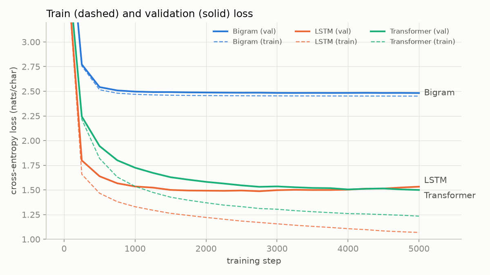
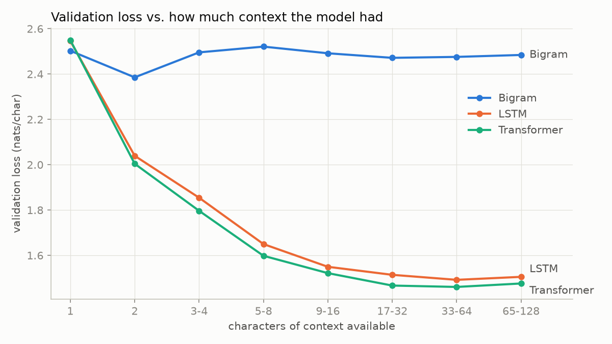
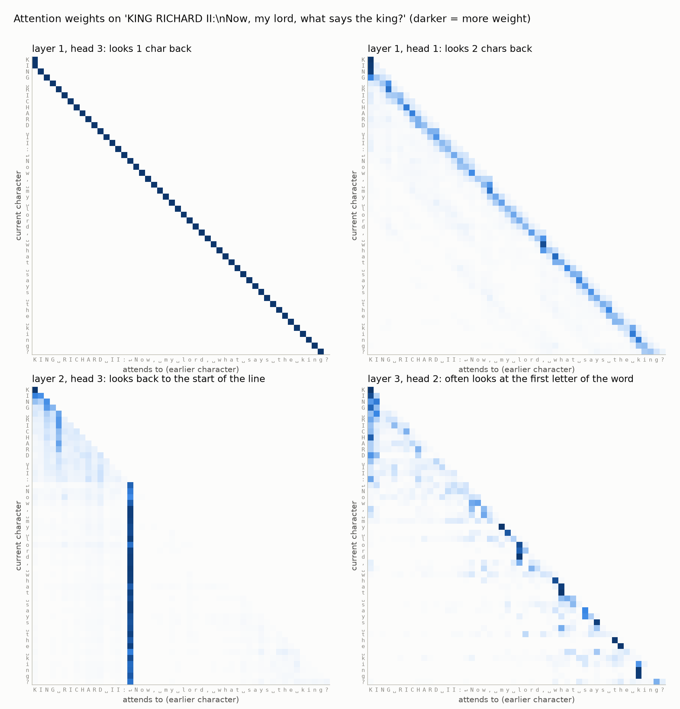

# Bigram vs LSTM vs Transformer on Tiny Shakespeare

Midterm project: train three language models of increasing complexity on the same text and
the same task, and see what actually changes as you go from a lookup table, to a recurrent
network, to a model with attention.

The task is **next-character prediction**: given the characters so far, predict the next
one. All three models are trained on Tiny Shakespeare and scored the same way.

## Running it

```bash
python -m venv .venv
source .venv/bin/activate
pip install -r requirements.txt

python src/train.py --model bigram
python src/train.py --model lstm
python src/train.py --model transformer
python src/compare.py      # results table + plots in results/
```

`train.py` picks the Apple GPU (`mps`) or CUDA if there is one, otherwise CPU. You can force
it with `--device cpu`. On my laptop (Apple M5) all three take about 7 minutes in total.
It'll be slower on CPU, but this setup is small enough for a laptop or Colab.

```
data/input.txt          Tiny Shakespeare (included, ~1.1 MB)
src/data.py             loading, character vocab, train/val split, batching
src/models.py           the three models
src/train.py            training loop, final evaluation, text generation
src/compare.py          results table + plots
results/                per-model JSON, samples/, plots, results_table.md
ai_use_summary.md       how I used AI on this project
```

## Dataset

[Tiny Shakespeare](https://raw.githubusercontent.com/karpathy/char-rnn/master/data/tinyshakespeare/input.txt)
from Andrej Karpathy's char-rnn repo. It's about 40,000 lines from several Shakespeare plays
in one text file, 1,115,394 characters in total. The file is already in `data/input.txt`.
If it's missing, `src/data.py` downloads it from the link above, or you can grab it
yourself:

```bash
curl -o data/input.txt https://raw.githubusercontent.com/karpathy/char-rnn/master/data/tinyshakespeare/input.txt
```

I didn't clean the text. Since this is character-level, capitals, punctuation and newlines
are all part of what the model has to learn (the speaker-name-in-caps-then-colon format is
a nice thing to watch for in the samples). The vocabulary is just the 65 unique characters
in the file.

The split is the first 90% of the file for training (1,003,854 chars) and the last 10% for
validation (111,540 chars). I didn't shuffle, so validation is a separate block of text:
mostly the second half of *The Taming of the Shrew* and the start of *The Tempest*. Names
like PETRUCHIO, KATHARINA and PROSPERO show up a lot in validation but rarely or never in
training. Because of that the validation loss is a bit harder than a random split would be,
which is what I wanted.

## Keeping the comparison fair

The comparison only means something if the models get the same conditions, so these are
the same for all three:

- **Data:** same text, same split, same 65-character vocabulary.
- **Training budget:** 5,000 steps with batches of 64 sequences × 128 characters. That's
  about 41M characters seen, or roughly 41 passes over the training text.
- **Context:** neither the LSTM nor the transformer ever sees more than 128 previous
  characters. The LSTM's hidden state starts from zero for every 128-character chunk, the
  same as the transformer's window. The bigram only ever gets 1.
- **Optimizer:** AdamW with gradient clipping at 1.0 and the same random seed.
- **Model size:** the LSTM and the transformer are about the same size (947k and 825k
  parameters), so the transformer can't win just by being bigger. The LSTM is actually
  slightly larger.
- **Evaluation:** final train/val loss is computed over the *entire* split, cut into
  non-overlapping 128-character chunks, with dropout off. Every model is scored on exactly
  the same characters. The loss curves during training use a fixed set of 50 batches,
  also identical for every model.
- **Timing:** same machine and device. The training-time number only counts the training
  steps, not the periodic evaluations.
- **Sampling:** 500 characters, temperature 1.0, seed 42, same two prompts (`"\n"` and
  `"ROMEO:\n"`).

The one thing that differs is the **learning rate** (bigram 1e-2, LSTM 2e-3, transformer
1e-3). Using one rate for everything would be unfair in its own way. The bigram is a plain
lookup table and barely moves at 1e-3 in 5,000 steps, while transformers are known to get
unstable at higher rates. These are standard starting values for each kind of model, but I
didn't run a proper sweep, so each model could probably gain a little with tuning.

## The three models

### 1. Bigram

`BigramLM` in `src/models.py`. The whole model is a single 65 × 65 table. Row *i* holds
the scores (logits) for which character comes after character *i*. To predict, you look
up the row for the current character and apply softmax. Training with gradient descent
pushes each row toward the actual next-character frequencies in the data. So it ends up
as the same model you'd get by counting character pairs. As a sanity check, `train.py`
builds the counted version too, and the two land on the same validation loss (2.4817
trained vs 2.4819 counted).

- **What it uses:** only the current character.
- **What it ignores:** everything else, including the rest of the word it's in, the
  line, who is speaking, and whether it's partway through a name.
- **Why its understanding is limited:** after an `e` it has to give the same prediction
  whether it's in "th**e**", "Rom**e**o" or "h**e**ar". It can learn local spelling habits
  (`q` is followed by `u`, a space is often followed by `t`), but it can't know what word
  it's in, so it can't spell anything longer than two letters on purpose. It has no memory
  at all.

### 2. LSTM (the non-transformer model)

`LSTMLM`: character embedding (65 → 128) → 2-layer LSTM with 256 hidden units → dropout →
linear layer back to 65 logits. 947k parameters.

The LSTM reads the text one character at a time, left to right. It carries a hidden state
(and a separate cell state) from step to step, and gates decide at each step what to
forget, what to write into the cell state, and what to output. The prediction for the next
character comes from that state, so in principle it depends on *everything* read so far in
the chunk, not just the last character.

- **How it uses more context than the bigram:** after reading "Rom" the state can record
  "we're in the middle of a word that started with capital R-o-m", so after the next `e`
  it predicts `o`. A bigram can't do that. It can also track things like "we're at the
  start of a line after a speaker name".
- **What it improves:** spelling of real words, word lengths, punctuation in sensible
  places, and the overall "NAME:\nline of verse" layout.
- **Why it still struggles with long dependencies:** everything it remembers has to fit in
  a fixed-size vector (256 numbers per layer) that gets overwritten a bit on every
  character. Information from 80 characters back has been through 80 updates and is
  mostly gone or blurred. The gates help with vanishing gradients compared to a plain
  RNN, but they don't remove the bottleneck. It also has to process characters one after
  another, so it can't be parallelized across the sequence. That makes each training step
  slower than you'd expect for its size.

### 3. Small transformer

`TransformerLM`: a small GPT-style decoder, 825k parameters. Everything in it is written
out by hand in `src/models.py`. I didn't use `nn.Transformer` or
`nn.MultiheadAttention`, so all the pieces are visible:

- **Token embeddings:** each of the 65 characters → a 128-dim vector.
- **Positional information:** a learned 128-dim embedding for each position 0–127, added
  to the token embedding. Without it, attention would treat the context as an unordered
  bag of characters.
- **Self-attention:** 4 heads of causal self-attention per block. Every position makes a
  query ("what am I looking for?"), a key ("what do I contain?") and a value ("what do I
  pass on if picked?"). The query·key scores get scaled and masked so a position can only
  look backwards, then go through softmax to become weights. Each position's output is
  the weighted average of the values. Any character can pull information from any earlier
  character in the window in one step, no matter how far back it is.
- **Feedforward layer:** after attention, each position goes through its own small MLP
  (128 → 512 → 128 with GELU). Attention mixes information between positions, and the MLP
  processes it at each position.
- **Residual connections + LayerNorm** around both parts (pre-norm), 4 of these blocks stacked.
- **Output layer:** final LayerNorm, then a linear layer to 65 logits for the next character.

Dropout is 0.1 and the weights are initialised with N(0, 0.02), like GPT-2.

## Results

| Model | Params | Train loss | Val loss | Training time | Generated text quality | Notes |
|---|---:|---:|---:|---:|---|---|
| Bigram | 4,225 | 2.454 | 2.482 | 5 s | Low | 24% of generated words are real. Gets letter pairs right and nothing else. |
| LSTM | 946,625 | 1.075 | 1.528 | 139 s | Medium | 93% real words. Val loss bottomed out around step 2750 (~1.49) and then got worse as it overfit. |
| Transformer | 824,897 | 1.239 | **1.495** | 233 s | Medium | 91.5% real words. Lowest val loss and the smallest train/val gap. Still improving at step 5000. |

Losses are cross-entropy in nats per character (lower is better). For reference, guessing
uniformly among 65 characters would be ln(65) = 4.17. In bits per character, the validation
losses are 3.58 / 2.20 / 2.16. Training time is wall-clock for 5,000 steps on an Apple M5 GPU
(0.9 / 27.8 / 46.6 ms per step).

"Real words" is a rough automatic check I added because judging samples by eye felt too
subjective. Each model generates 20 samples of 500 characters, and I count what fraction of
the generated words appear anywhere in the training text (`results/sample_stats.json`).



The loss curves show the main story. The LSTM learns much faster at the start: by step 250
it's already at 1.80 val, where the transformer is at 2.24. It flattens out by around step
1500, and after ~2750 its validation loss starts creeping back up while its training loss
keeps falling. That's overfitting. The transformer is slower to get going but keeps
improving the whole way, and it passes the LSTM in the last few hundred steps.



This plot breaks the validation loss down by how many characters of context the model had
when making the prediction. The first character of each 128-character chunk has 1 character
of context and the last has 128. The bigram is flat, as it should be, since it ignores
context. The other two drop fast over the first ~16 characters and then flatten out.
The transformer is lower at every context length from 2 onward.

At 1 character of context, all three models are really just bigram models, and they all
score about 2.5. That's a nice sanity check. (The LSTM and transformer are actually slightly
*worse* than the bigram there, because only 1 in 128 of their training positions looks like
that.)

## Generated samples

All samples use temperature 1.0 and the same seed. These are the first lines of the
`ROMEO:` prompt sample from each model. The full samples, including a second prompt, are in
`results/samples/`.

**Bigram**
```
ROMEO:
b'Tho in w rif ofowhacind; mares hayofire y.
To to bbot s!

Whowisofr os an s nfalounsand t th po fuensty; th at
The, walser.

PSans se sigr k tht?
D:
ARCHM:
BARD: t dis?
```

**LSTM**
```
ROMEO:
P'lroaten to first ha! no; marry, sir: all I be to bed,
sir, so--
You on an upurachers, banish'd from strings,
And when I command, sir, since he hath,
And made our train? I saw will not stir by praise.

HENRY BOLINGBROKE:
Yea, Benave Marcius: crook-lect me,
Her person I'll more than have to draw;
```

**Transformer**
```
ROMEO:
Provost! who from charing that?

CLARENCE:
Is witness'd sorrow with himself speed but a
father point. O you have
To thinks your canst by increase
He not, sir? And it did?

PAULINA:
Put night, I pray your patient six,
Before I been this straight of the flatter: they seem'd
```

The **bigram** output looks like Shakespeare only from far away. It has short lines, capital
letters after newlines, things that look like `NAME:` lines, and common pairs like `th`,
`an` and `s ` (an `s` followed by a space). But almost none of the words are real, and the
"speaker names" (`ARCHM:`, `BARD:`) are invented, because it can't know it's in the
middle of a name. None of the 62 speaker lines it generated in the stats run is a real
character.

The **LSTM and transformer** are a big jump from that, and honestly hard to tell apart.
Both have the play format down: real character names (HENRY BOLINGBROKE, CLARENCE,
PAULINA), a newline after the colon, verse-length lines that start with a capital letter,
and sensible punctuation. Most words are real, with a few made-up ones like "upurachers"
and "charing". What neither can do is make sense for more than a few words. "To thinks your
canst by increase" is grammatical-looking nonsense. They also mix characters from
different plays into the same scene.

One thing I noticed: with the same seed, the LSTM and transformer samples for the `"\n"`
prompt start out almost identically (`MENENIUS:\nShould I in pla...`) and only drift apart
after a few lines. Sampling uses the same random numbers for both, so this means the two
models learned very similar probabilities, even though they work completely differently.

## Comparison

**Which model performed best?** The transformer had the lowest validation loss, 1.495
against the LSTM's 1.528. It's also lower at every context length (plot above) and has a
much smaller gap between train and val loss (0.26 vs 0.45). The margin is small though,
about 2%. The LSTM's best validation loss during training (~1.49 at step 2750, on the
periodic estimate) was about the same as where the transformer finished. So the honest
answer is that the transformer generalized better and still had room to improve, while the
LSTM had already started memorizing the training set. It didn't learn dramatically more.
Both are far ahead of the bigram.

**Which model trained fastest?** The bigram, obviously (5 seconds, since it's a lookup
table). Between the two real models, the LSTM was faster: 28 ms per step vs 47 ms, and it
hit its best validation loss after only ~77 seconds. That surprised me, because the usual
argument is that transformers train faster since they process all positions in parallel.
My guess is that it's about scale and implementation. PyTorch's `nn.LSTM` is a single built-in
op that PyTorch has optimized. My transformer is attention written by hand, a lot of small operations, and it
builds a full 128 × 128 attention matrix for every head in every layer. The parallel
advantage matters more with longer sequences and bigger models. Using PyTorch's built-in
`scaled_dot_product_attention` would probably close some of the gap, but I didn't test that.

**Which model generated the most realistic text?** It's basically a tie between the LSTM
and the transformer. By my word check the LSTM is actually slightly ahead (93.2% vs 91.5%
real words, 85.4% vs 84.5% real speaker names). I think that's partly the overfitting
showing: it memorized more of the training text, so it spits out more training-set words.
The bigram is clearly last.

**What did the transformer improve compared to the other models?** Compared to the
bigram, it uses context at all. Compared to the LSTM, two things:

1. It's better at every context length, not only long ones. The gap is biggest with 3–8
   characters of context (about 0.05 nats). Attention can read the exact previous
   characters directly instead of trying to recover them from a compressed hidden state.
2. It generalizes better (smaller train/val gap, still improving when training stopped).

What it *didn't* do in my setup is win specifically on long-range context. Both models stop
getting anything out of extra context after about 32 characters. For next-character
prediction on Shakespeare, the useful information is mostly the current word and the one
or two before it. The 128-character window is more than either model really uses.

**Was the improvement worth the added complexity?** For this exact setup, not really. It's
2% lower validation loss for 1.7× the training time and noticeably more code, and the
samples look about the same. If I had to train something on my laptop in two minutes, I'd
take the LSTM. But the curves point the other way for anything bigger. The LSTM had already
plateaued and started overfitting, while the transformer was still improving. With more
steps, more data or a bigger model, I'd expect the gap to grow. That's the reason the field
moved to transformers, but my run is too small to show it directly. One extra benefit is
that attention can be inspected (see below), which helped a lot in understanding what the
model was doing. You can't really do that with an LSTM's hidden state.

**What did I learn about attention?** I plotted the attention weights for a line from the
validation set. Several of the sixteen heads have very clear jobs. Here are four of them:



- **Layer 1, heads 3 and 4** look exactly one character back. **Heads 1 and 2** mostly
  look two back. So the first layer rebuilds a trigram-style view on its own: after layer 1 every
  position knows itself plus the two characters before it.
- **Layer 2, head 3** looks back to the most recent newline. Every character in "Now, my
  lord, what says the king?" puts its attention on the `↵` at the start of the line,
  whether it's 1 character away or 33. That tells the model where it is in the line and
  whether it's inside a speaker name or a line of verse.
- **Layer 3, head 2** often looks at the first letter of the current word (the `o`,
  `r`, `d` and the comma in "lord," all look at the `l`, and "ing" all look at the `k` in "king").
  Knowing how a word starts is exactly what you need to spell the rest of it.

Nobody programmed these patterns; they come out of training. What stood out to me is that
distance doesn't matter to attention. Jumping back 33 characters to the newline is as easy
as looking at the previous character, and *where* a head looks depends on the content (find
the newline, find the word start), not on a fixed offset. An LSTM would have to carry
"where did this line start" forward through every single step in its hidden state. You
can also see the layers build on each other: layer 1 gathers neighbours, and later layers
can use that to find things like "the start of this word".

## Reflection

*After comparing bigram, non-transformer, and transformer models, what do you think makes
transformers powerful for language modeling?*

The biggest jump in this project wasn't LSTM → transformer, it was bigram → anything that
uses context. Going from 1 to about 16 characters of context took the loss from ~2.5 to
~1.5. The difference between the LSTM and the transformer is tiny next to that. So the first
thing a language model needs is a way to use what came before.

What makes the transformer powerful isn't that it sees *more* context. My LSTM saw the same
128 characters. It's *how* it gets to that context. The LSTM has to squeeze everything it
has read into a fixed set of numbers and update them after every character, which means it
has to decide in advance what's worth remembering. The transformer keeps every earlier
position around and lets each position decide, based on content, what to look up when it
needs it. The attention heatmaps make this really concrete: one head finds the start of the
line 33 characters back as easily as another head finds the previous character. Nothing
gets forgotten along the way, because nothing has to be carried.

The second part is how it scales. Since there's no step-by-step recurrence, training
processes all positions at once, and in my run it overfit less and was still improving when
the LSTM had already stalled. My experiment is too small to show the transformer winning by
a lot. Honestly, the most surprising result was how close the LSTM got. But the shape of the
curves gives a pretty good idea of why transformers pull ahead once the model and data get
bigger.

## What I learned

- Context length matters more than anything else here. Even a couple of characters of
  context is a huge improvement over a bigram.
- The final checkpoint isn't always the best one. The LSTM was at its best around step 2750
  and got worse after that. Without the validation curve I would have just reported the
  final number and not known.
- "Transformers are faster to train" depends on scale and implementation. At this size the
  LSTM was faster per step on my laptop.
- Loss is more sensitive than reading samples. The LSTM and transformer samples look about
  the same to me, but the loss and the per-context plot show a consistent difference.
- Attention heads end up with simple, readable jobs, and plotting them was the clearest way
  to see why attention helps.

## Limitations

- Each model was trained once with one seed. A 0.03 difference in validation loss could
  partly be run-to-run noise, so I'd want a few seeds before calling it definitive.
- Learning rates are reasonable defaults, not tuned with a sweep.
- A fairer best-vs-best comparison would use early stopping (keep the checkpoint with the
  lowest val loss). The LSTM would look slightly better that way.
- Everything is character-level with a 128-character window. A word-level tokenizer or a
  longer window would probably give attention more to work with.

## Use of AI (Claude)

I used Claude Code (Anthropic) for this project. It wrote most of the code and the first
draft of this README, ran the experiments, and pushed the repo. The details are in
[`ai_use_summary.md`](ai_use_summary.md), and the commits are marked as co-authored with
Claude. I tried to keep it honest in a few concrete ways. Every number in this README comes
from the JSON files the scripts write; nothing is typed in by hand. The samples are raw
output with a fixed seed, not cherry-picked. The bigram has a counting-based sanity check.
The limitations above say plainly where the comparison could be better. Anyone can re-run
the four commands at the top and check the results.
